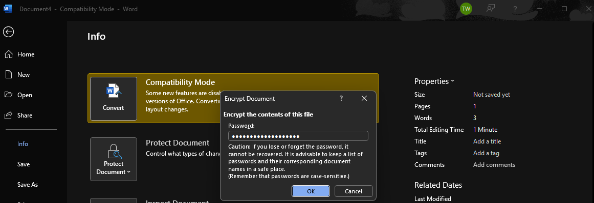

# Cryptography & Data Protection Fundamentals

Coursework demonstrating document-password protection, AES encryption/decryption, hashing, and a file-based information-hiding exercise.

**Author:** [Tenny Wu](https://github.com/714tenny)  
**Project type:** Academic lab / historical case study  
**Status:** Source work documented; scope and validation limits recorded below

## Context

Foundational IS-3423 coursework dated September 22, 2025. Only screenshot-backed activities are described; no production encryption system was built.

## Tools

Windows Command Prompt, Microsoft Word, browser-based AES-128 and hash demonstration utilities

## Key results

- Reviewed Microsoft Word document-password protection and captured the encryption menu/password prompt.
- Demonstrated AES-128 encryption/decryption with sample text.
- Generated an MD5 hash in a demonstration utility and distinguished hashing from reversible encryption.
- Performed a binary file-combination information-hiding exercise without claiming cryptographic protection or undetectable steganography.

## Documentation

- [Investigation notes](docs/investigation.md)
- [Sources and screenshot index](docs/source-and-evidence.md)

## Evidence preview

See the [evidence index](docs/source-and-evidence.md) for source-page references and the limits of each observation.

## Skills demonstrated

Confidentiality and integrity concepts, document protection, symmetric encryption, hashing, information-hiding limitations.

## Evidence boundaries

This repository presents authorized coursework and its recorded evidence. It does not represent a live production incident, newly validated remediation, or a deployed security product. Conclusions, uncertainties, and source discrepancies are documented in the investigation notes.
